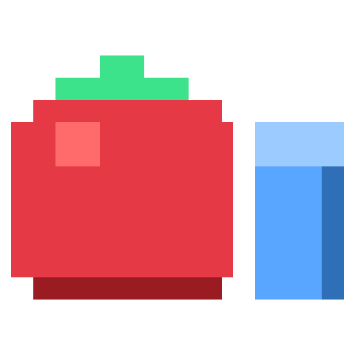

# Pixel Pomo Dev Kit



A desktop program (Windows and macOS) that shows an artist's own work **inside
Pixel Pomo's garden** before it is in the game: a 2D sprite exported from the
Art Kit, or a 3D model saved from MagicaVoxel. Add the file, pick it on the
shelf, click a tile.

It is not a preview that looks like the game. The garden is drawn by the game's
own engine (`App/flutter/lib/engine`, used as a package, not copied) and a
`.vox` is converted by the game's own `vox_to_boxes.py`, so what stands in the
kit's garden is what the game will draw.

**Status: v0.1.1, not released** (no tag, so UPDATE has nothing to fetch yet)**.** Built and checked on Windows
only. The macOS build, its one-line installer and the release workflow are
written but have never run — see [What has and has not been tried](#what-has-and-has-not-been-tried).

## Installing

The download is the program. Started from anywhere that is not an install it
opens a **setup window** instead of the kit: where should the Dev Kit live?

| | suggested | |
|---|---|---|
| Windows | `C:\Program Files\PixelPomoDevKit` | plus a shortcut on the Desktop (a tick box) |
| macOS | `/Applications/PixelPomoDevKit` | `~/Applications/…` where that is not writable |

Type or BROWSE to another folder to change it; the kit always gets a folder of
its own (`D:\Tools` becomes `D:\Tools\PixelPomoDevKit`). INSTALL copies the
program there and opens it. A newer download started later finds the install
and offers **UPDATE** instead, files kept.

**Program Files belongs to the system**, so installing there takes the one
permission question every Windows installer asks. The setup says so under the
folder box before INSTALL is pressed. Behind it the program starts itself once
more, with that permission, as `PixelPomoDevKit.exe --place <folder>`: it copies
the kit, gives the artist's account the right to write in the kit's own folder
(`Files` is in it, and an update replaces the program in it) and stops. The
Desktop shortcut and the note of where the kit is are made afterwards, as the
artist. A folder the account can already write is installed into with no
question. Answering no installs nothing and says so.

**`dist` on the build machine is itself an install.** `build.py` ends by writing
the marker beside the program it built, so `dist\PixelPomoDevKit.exe` opens the
kit, files in `dist\Files`, and a rebuild leaves those files alone. To see the
setup, start a copy of the program from any other folder. (Not in CI.)

**On a Mac the install is one line in Terminal** (`install-mac.sh`, in
`READ-ME-FIRST-MAC.txt`). The kit is not signed with an Apple Developer ID, and
macOS quarantines whatever a *browser* downloads — which is the "cannot be
opened" warning and the trip through System Settings that the Art Kit's Mac
guide spends two pages on. A file fetched with `curl` is not quarantined, so
the same app opens with no warning at all. The other question the Art Kit's
artists met, "allow access to Documents?", cannot come up: the kit keeps
nothing in Documents, Desktop or Downloads.

## Where the files are

**One folder, the one chosen at install.** Everything the artist added is in
`Files` inside it:

```
C:\Program Files\PixelPomoDevKit\      (Mac: /Applications/PixelPomoDevKit/)
    PixelPomoDevKit.exe                (Mac: PixelPomoDevKit.app)
    devkit-install.json                "this folder is an install"
    Files\
        library\<id>\                  one folder a thing:
            CoffeeLocal.vox                the file as it was picked, under its own name
            mesh.json                      a model: the box mesh the garden draws
            meta.json                      what it is, and every choice made
        trash\                         what was taken off the shelves, until deleted
        state.json                     the garden as last left
        devkit.log                     the first place to look when something is wrong
        updates\                       the previous program, for a way back
```

**An update replaces the program and nothing else.** No installer and no
updater writes inside `Files`; only the running kit does. Click the version
number, top left in the kit, to see these folders and open them.

Running from source the files are in `DevKit\_data\`; `DEVKIT_DATA` pins them
anywhere (and skips the setup). v0.1.0 kept them in `%LOCALAPPDATA%\PixelPomoDevKit\`:
the first start of v0.1.1 copies that library and garden into `Files`, once,
and leaves the old folder as it was.

## What is on the screen

| | |
|---|---|
| **v0.1.1** (the version, beside the title) | Opens ABOUT: which kit is running and where the program, the files and the trash are. Each path opens its folder. |
| **VIEW** — `WEB` / `MOBILE` | The garden as the browser build shows it (the whole stage, wide), or on a phone's upright screen (412×915, a current tall Android phone, scaled to fit). The camera angle carries over between the two. |
| **ADD** | `ADD 2D SPRITE` (a `.png`), `ADD 3D VOX FILE` (a `.vox`), and `IMPORTED FILES`, the list of what has been added. |
| **GUIDE** | The steps below, on screen. |
| **GARDEN** — `SHRINK` / `EXPAND` / `CLEAR` | Resize the plot the way the game's EXPAND does (+2 columns, +4 rows), and back. 4×8 (the game's start) to 16×32. |
| **UPDATE** (top right) | Says `UPDATE v0.1.2` when a newer kit is out. Click: it downloads, closes, and opens again as the new version. |
| **TRASH** (top right) | What was taken off the shelves, with a count. `PUT BACK`, `DELETE`, `EMPTY THE TRASH`. The only place the kit deletes anything. |
| the garden | The game's garden, in the forest as usual. Right-drag turns it, the wheel zooms, drag or WASD moves it. |
| the shelf | Every object of the game plus everything added, on the market's four shelves — FLOWERS, OUTER DECOR, INNER DECOR, PETS. Each carries a **2D** or **3D** label. Pick one, click a tile to place it, click the tile again to take it off. ERASER clears a tile. **Right-click** one for its details. |

**2D or 3D.** A 2D sprite always faces the camera; a 3D model is real geometry
that stays put while the garden turns round it.

| | label |
|---|---|
| flowers, and any sprite added as STANDING | 2D |
| paths, and any sprite added as FLAT GROUND | 2D |
| fences | 3D |
| houses, the four voxel test models, and every `.vox` added | 3D |

## Adding a file

**A 2D sprite.** In the Art Kit, *Export engine sprite* writes the `.png`. The
kit reads what it is from the name the Art Kit gave it:

| exported as | offered as |
|---|---|
| `flower_<name>.png`, `flower_<name>_<n>.png` | STANDING, on the FLOWERS shelf |
| `tree_07.png`, `bush_03.png`, `rock_01.png` | FOREST — takes that sprite's place in the woods round the garden |
| a name with `road`, `path`, `floor`, `ground`, `tile` or `concrete` in it | FLAT GROUND, on OUTER DECOR |
| anything else | STANDING |

Every choice can be changed in the dialog before pressing ADD.

**A 3D model.** Save the model in MagicaVoxel and add the `.vox`. The dialog
has the choices on the left and **the model on the right**, standing on a patch
of garden tiles, following every choice as it is made; drag the picture to walk
round it.

- **which model**, when the file holds several — one model becomes one object;
- **size** — `ORIGINAL SIZE` (16 voxels to a tile, said once beside the dialog's title), or `FIT TO TILES` with a footprint typed in: so many tiles **wide**, so many **long**, each from 0.25 to 16. The model is made as large as goes into that footprint both ways and keeps its shape; the footprint is outlined on the ground;
- **turn** — any whole angle from 0 to 360, typed, on a slider, or 0 / 90 / 180 / 270 at a click. At 0, MagicaVoxel's front (−y) faces the camera;
- **shelf**.

While the launcher reads or converts a file the kit says so — `PLEASE WAIT`,
the step it is on, and how long it has been — and a dialog that is waiting for
a preview shows `CONVERTING`. Only colours come across; glass, emission and
metal are ignored. A model that needs more than 10 000 boxes is refused, and
one over 2 500 is added with a warning — nothing that large has been measured
on a phone.

**How an angle that is not a quarter turn is kept.** A box mesh is axis-aligned
boxes, so the converter can only write quarter turns into them. The rest rides
in the mesh as `"turn": <degrees>`, which the game's painter adds to the camera
for that one object (`BoxMesh.turn`, `App\flutter\lib\engine\garden_engine.dart`).
137° is a quarter turn in the boxes and 47° in that field. A fit is measured
after the quarter turns; the leftover angle makes the model overhang its
footprint a little.

## Details, CHANGE and the trash

**Right-click** a tile on the shelf:

- something **added**: every choice made when it was added, written out —
  file, model, size, what it comes out as, turn, boxes, shelf — and where the
  kit's copy of the file is. Under them, **CHANGE** opens the same dialog as
  ADD, filled in as the choices were made; the model is converted again from
  the kit's own copy, and keeps its id, so every one of it in the garden
  changes where it stands. **MOVE TO TRASH** takes it off the shelf and out of
  the garden;
- one of the **game's** objects: what it is. It cannot be changed or thrown
  away here.

**Nothing is deleted by taking it off a shelf.** The whole folder — the
artist's file included — moves to `Files\trash`. TRASH, top right, puts a
thing back or deletes it for good, and asks first. Adding a second sprite for
the same forest tree sends the first one to the trash too, rather than
overwriting it.

## Updates

On start the kit asks GitHub once for the latest release of
`hero-999-dev/pixel_pomo_dev_kit` (`dev_kit/version.py`); UPDATE lights up if
there is a newer one. Pressing it downloads this machine's zip, unpacks the
new program beside the running one, closes the window, and a small script
swaps the two and starts the new kit.

- After an update there is **one** program in the folder. The old one is kept
  for a way back in `Files\updates\`, the latest only — not beside the new one
  as a second program (the Art Kit's artists asked for exactly this; its
  v3.0 draft, item 1).
- **A Mac updates itself too**, where the Art Kit only opens the release page:
  the kit downloads the zip itself, so macOS does not quarantine it.
- A kit that is not installed (run from source, or with `DEVKIT_DATA`) says
  that a newer version exists and where; it does not swap itself.

**That repository does not exist yet** — nothing has been pushed — so today
UPDATE answers "No version of the Dev Kit has been published yet." The
mechanism itself has been run end to end against a pretend release (below).

## How it is put together

```
PixelPomoDevKit.exe / .app
 ├─ the launcher (dev_kit/, Python)      sets the kit up, opens its window, keeps
 │                                       the artist's files, converts .vox files,
 │                                       updates the program
 ├─ the page (app/, Flutter web)         the screen: the game's garden engine,
 │                                       the bar, the shelf, the dialogs
 └─ vox_to_boxes.py, obj_to_boxes.py     the game's converters, bundled
```

| `dev_kit/` | |
|---|---|
| `installer.py` | the setup window, the install, the desktop shortcut |
| `paths.py` | where the program, the files and the window's cache are |
| `library.py` | the artist's files: adding, converting, changing, the trash |
| `server.py` | the page and what it asks for, on 127.0.0.1 only |
| `updater.py` | checking, downloading, the hand-off that swaps the program |
| `window.py`, `app.py` | the kit's own window, starting and stopping |

**The window is the program's own**: its title, its icon in the title bar and
on the taskbar, closed with its X — and closing it ends the program. What is
drawn inside it is the page, shown by the web view the system already has
(WebView2 on Windows, WKWebView on a Mac) through `pywebview`. The launcher
serves the page to that window on 127.0.0.1 and nothing else can use it. The
setup window is made the same way.

Why the screen is a Flutter *web* build inside a web view rather than a Flutter
desktop build: this machine has no Visual Studio, which `flutter build windows`
needs, and the browser build of the game already runs here. The Dart code has
nothing browser-specific in it except `lib/pick_web.dart` (the file dialog), so
that move is a packaging change later, not a rewrite.

On a Windows with no WebView2 runtime (it is part of Windows 11 and of any
Windows 10 with an up-to-date Edge) the kit cannot make its own window; it
opens the page in Edge or Chrome's app mode instead, and failing that as a tab
in the default browser. The setup there is a plain yes/no box.

**A scene file is cut down to the one model asked for** before the game's
converter sees it (`library.one_model`): the game's reader reads every voxel
of every model to convert one, which is two seconds a step for a 9 MB file of
nine models. The cut file holds that model's own chunks and the palette,
byte for byte, so the converter does the same work on it — a test converts
each model both ways and compares the meshes.

**Two changes in the game**, both additive, both uncommitted in `App\`:

- `Placeables` (`lib/logic.dart`) has two run-time sets, `importedRoadIds` and
  `importedHouseIds`, which the game leaves empty and the kit fills, so the
  game's painter lays an added ground flat and draws an added model as
  geometry.
- `BoxMesh` (`lib/engine/garden_engine.dart`) reads an optional `turn` in
  degrees and `paintMesh` adds it to the camera for that mesh. A mesh without
  it — every mesh the game ships — is drawn exactly as before. The Android
  live wallpaper's own renderer (Kotlin) does not read `turn` yet.

**The four voxel test models** (`App/flutter/test_assets/`) are in the kit's
catalogue as worked examples of a `.vox` that came in well. They are other
people's models, credited in the App's README; they stay out of the real app.

## Running and building

Once, for the launcher: `python -m pip install -r DevKit\requirements.txt`
(pywebview for the window, certifi, PyInstaller for packaging). Then, from the
`Pixel Pomo` root, in PowerShell:

```powershell
# run from source (builds the page first if it has never been built)
powershell -ExecutionPolicy Bypass -File Terminal\dev-kit.ps1

# rebuild only the page, after changing the Dart code
powershell -ExecutionPolicy Bypass -File Terminal\dev-kit.ps1 -Page

# package dist\PixelPomoDevKit.exe
powershell -ExecutionPolicy Bypass -File Terminal\dev-kit.ps1 -Build
```

`build.py` is the recipe behind all three (`sync_assets.py` → `flutter build
web` → PyInstaller), and is what CI runs. **DevKit and App must stay
siblings**: the page depends on the game by relative path, and the build
copies the game's art in from `..\App`.

Tests:

```powershell
cd DevKit;      python -m unittest discover -s tests -t .     # the launcher (142)
cd DevKit\app;  flutter test                                   # the page (67)
```

For looking at the page in another browser, or driving it from a script:

| | |
|---|---|
| `DEVKIT_DATA` | keep the files here, and never ask to install |
| `DEVKIT_NO_WINDOW=1` | start the launcher without a window and print its address |
| `DEVKIT_PORT` | the port to listen on |
| `DEVKIT_WINDOW=browser` | skip the native window |
| `DEVKIT_UPDATE_API` | ask this address for the latest release instead of GitHub |
| `WEBVIEW2_ADDITIONAL_BROWSER_ARGUMENTS=--remote-debugging-port=9444` | attach a debugger to the page *inside* the native window (the setup window too) |

## What has and has not been tried

Tried, on this Windows machine, with the packaged `.exe` and a debugger
attached to the page inside its own windows:

- **setup**: a first start offers `C:\Program Files\PixelPomoDevKit` and says Windows will ask for permission, refuses what is not a full path, installs into a typed folder (with a folder of its own), writes the program, the marker and `Files`, and opens the installed kit;
- **what v0.1.0 left** is brought over on that first start — a real v0.1.0 library and garden, from a stand-in for `%LOCALAPPDATA%`;
- **a newer build started as a download** says the kit is installed, offers UPDATE, replaces the program and keeps every file;
- **UPDATE**, against a pretend release served on this machine: the button says `UPDATE v0.1.2`, the kit downloads it, closes, and opens as 0.1.2 about ten seconds later, with one program in the folder, the 0.1.1 one in `Files\updates`, and the library untouched;
- **UPDATE with nothing published**: asks the real GitHub address and says so;
- **ADD 3D VOX FILE** with a 9 MB file of nine models: the reading panel, the model list, the preview following size, turn and a dragged view, a fit and a turn typed in, the three-step `PLEASE WAIT`, the model on its shelf with its file kept under its own name;
- **details, CHANGE, the trash**: a right-click's details, CHANGE converting again from the kit's copy, MOVE TO TRASH, the count on the bar, PUT BACK;
- **a 9 376-box model**, placed twice: the window keeps answering at about 32 frames a second (Intel Iris Xe);
- the version number's panel, the daisy's two models and the chamomile on the FLOWERS shelf.

From v0.1.0 and still true: the window is the program's own, a second start
brings the first to the front, closing it ends the program within a few
seconds, sprites / grounds / forest sprites are added and placed, and
everything is still there after a restart.

Not tried:

- **Windows' permission question itself.** Installing into the suggested `C:\Program Files\PixelPomoDevKit` needs someone to answer it, and the account this was built under is not an administrator. Everything on both sides of the question was run with the packaged program — the setup says the question is coming, `--place` puts the kit in a folder and opens it to an account, the setup carries on from its report — but the question was never put and never answered here. If it goes wrong, the setup's words and `%LOCALAPPDATA%\PixelPomoDevKit\setup.log` say how.
- **The windows on a desktop, by eye.** The sessions this was built in have no screen: both windows were created, driven and closed, and their contents captured, but their frames, title-bar icons and taskbar buttons have not been looked at by anyone here.
- **The desktop shortcut's look.** The shortcut is made and points at the program; its icon on a real Desktop has not been seen.
- **The folder BROWSE button** in the setup window: it opens the system's folder dialog, which a script cannot answer. The typed path was used instead.
- **macOS, entirely.** The `.app` bundle, `install-mac.sh`, the Mac half of the installer and the Mac update hand-off are written from Apple's documented behaviour and from the Art Kit's working Mac build; none of it has run. PyInstaller cannot cross-compile, so the first Mac build has to come from a Mac runner.
- **The release workflow.** There is no repository for it yet.
- **The fallback** for a Windows without WebView2 was exercised in v0.1.0's first build; its yes/no setup box was not.
- **Frame rate with a heavy imported model on a real phone.** The kit shows how a model looks, not how fast a phone draws it.
- **What went wrong on the first ADD in v0.1.0** ("it crashed on the first one, the next two worked"): not reproduced, and that machine's log could not be read from here. Windows recorded no crash. v0.1.0 showed nothing at all while a model was being converted, which for a large file is 10 to 25 seconds of a still window; v0.1.1 says what it is doing, cuts that time down, and writes every ADD and every error of the page to `devkit.log`, in a folder that can be read next time.

## Not built yet

- uninstalling: delete the folder and the Desktop shortcut by hand;
- dropping a file onto the window instead of going through ADD;
- reading an Art Kit drawing (`.json`) directly, without exporting a PNG first;
- stretching a model to a footprint (a fit keeps its shape);
- `turn` in the Android live wallpaper's renderer;
- the game's other languages — the kit is English only.
